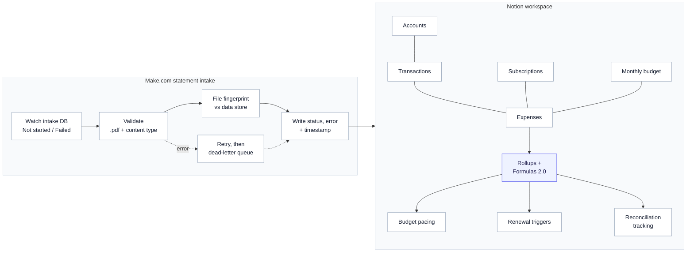

# Finance OS (Notion)

A finance system built in Notion that links accounts, transactions, expenses and subscriptions, with budget pacing, renewal triggers and reconciliation tracking. A Make.com pipeline handles statement intake: it validates uploaded PDFs, catches duplicates with a file fingerprint, retries failed items and writes status and errors back to Notion.

## Architecture

## How it works

1. **Model the money.** Accounts, transactions, expenses, subscriptions and monthly budgets are separate Notion databases linked by relations. Rollups and Formulas 2.0 compute spend against budget, upcoming renewals and which items are reconciled.
2. **Drop in a statement.** Adding a statement file to the intake database sets its status to *Not started*.
3. **Validate.** The pipeline checks the file name and the downloaded content type before doing anything with it.
4. **De-duplicate.** A fingerprint built from the file's size and slices of its data is checked against a data store, so the same statement is never processed twice, even if renamed.
5. **Report back.** Every item ends as *Done* or *Failed*, with the error text and a timestamp written back to the Notion row.

## Design decisions

- **Notion as the interface.** The database is both the control panel and the audit log: status, errors and timestamps all live next to the statement.
- **Fingerprint, not file name.** Renamed or re-uploaded statements are still caught.
- **Retries with a dead-letter queue.** Failed items are retried, then parked for review rather than silently lost.
- **Failures are visible.** A failed item stays in the database with its error, and can be retried by setting its status back.

## Stack

| Layer | Tools |
|---|---|
| Workspace and data model | Notion databases, relations, rollups, Formulas 2.0 |
| Automation | Make.com (database watch, routers, filters, HTTP, error handlers) |
| State | Make data store (file fingerprints) |
| Built with | Claude |
